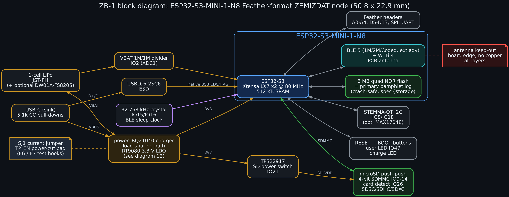
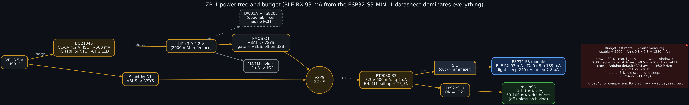

# ZB-1 — ZEMIZDAT development board (design rev 0.1, not yet fabricated)

ZB-1 is a small, battery-powered board that implements everything ZEMIZDAT-PROTO-1.0 needs. It
uses the Feather form factor (50.8 × 22.86 mm) and is programmable from the Arduino IDE.

* **Processor and radio:** ESP32-S3-MINI-1-N8 module, providing BLE 5 extended advertising, Wi-Fi and native USB.
* **Power:** USB-C single-cell LiPo charger with a load-sharing power path.
* **Storage:** 8 MB on-module NOR flash for the pamphlet log, plus a power-switched 4-bit microSD slot.
* **Test hooks:** a current-measurement jumper and a power-cut pad for experiments E6 and E7.

> **Status.** This is a design, not a tested board. The bring-up firmware compiles for this
> board definition (see §9). A complete KiCad 7 schematic, routed 4-layer PCB, fab outputs and
> 3D model are in [`cad/`](cad/README.md). Nothing has been fabricated or measured.
> * Prices marked *estimate* have not been quoted.
> * Every battery-life figure is arithmetic on datasheet currents.
> * Experiment E6 must replace those figures with measurements before anyone relies on them.

---

## 1. What the board must do (traceability to the spec)

| ZEMIZDAT requirement | Source | How ZB-1 meets it |
|---|---|---|
| BLE 5 **extended advertising**: anonymous, non-connectable, chained AUX PDUs, 2M secondary PHY | `03_protocol/spec.md` §3, `wire_format.md` | ESP32-S3 BLE 5 controller. NimBLE `NimBLEExtAdvertisement` with `setAnonymous(true)`, `setConnectable(false)`, `setScannable(false)`. **E1 must confirm on air** that the controller omits AdvA and chains 3 PDUs. |
| Passive scanning at a 5–30 % duty cycle | spec §5, `state_machine.md` | NimBLE passive scan; interval and window set in firmware. LISTEN never calls an advertising API. |
| Crash-safe NOR log; ~1 000 pamphlets | spec §storage, `08_verification` E7 | 8 MB on-module quad NOR. The log partition uses ~6 MB; the remainder holds the app and OTA. |
| Survive power loss at any instant (E7) | `08_verification` | **TP_EN pad** on the LDO enable (1 MΩ pull-up). An external MOSFET or the UNO R4 can cut 3V3 thousands of times. 22 µF bulk only, so power collapses quickly. |
| Measure energy (E6) | `05_hardware/battery_budget.md` | **SJ1** solder jumper between the LDO and the module: cut it to insert a µCurrent or PPK2. VBAT divider on an ADC1 pin. |
| Battery thresholds (stop TX below a reserve) | spec §budgets | VBAT/2 on IO2 (ADC1, usable while the radio runs). A MAX17048 footprint is available if better state-of-charge accuracy is needed. |
| Owner consent for firmware updates (button) | spec governance plane | BOOT button doubles as the user/consent button (IO0). Updates over USB only; no network update path enabled. |
| No identity on air | spec I1 | Nothing on the board adds one. USB descriptors carry no serial (`USB_SERIAL ""`), but USB is not radio. |
| Archive larger than the NOR | user requirement | microSD socket, 4-bit SDMMC, power-switched (§6). |
| Arduino IDE compatible | user requirement | Stock **arduino-esp32** core; `boards.txt` entry and variant provided (§9). |
| Small, cheap, battery powered with charging | user requirement | Feather size; ~$12 BOM+assembly at qty 100 [estimate] (§8); BQ21040 charger. |

## 2. Why the ESP32-S3-MINI-1-N8

| Option | BLE 5 ext adv in Arduino | SD host | Native USB | BLE RX current | Verdict |
|---|---|---|---|---|---|
| **ESP32-S3-MINI-1-N8** | yes (NimBLE-Arduino; Arduino BLE5 examples support S3) | **SDMMC 4-bit** | yes | **93 mA** (module datasheet) | **chosen for ZB-1**: best Arduino support plus a real SD host; same module as the UNO R4 WiFi already owned |
| ESP32-C6-MINI-1 | yes | SPI only | yes | ~73 mA [estimate] | no SD host; little benefit |
| ESP32-C3-MINI-1 | yes | SPI only | yes | ~80 mA [estimate] | cheaper, but fewer pins and no SDMMC |
| nRF52840 module (e.g. MDBT50Q) | Adafruit nRF52 core: limited ext-adv API; Zephyr is better | SPI only | yes | **6.26 mA** (datasheet) | **15× less receive energy**; better choice for a pocket device → **ZB-2** (§11) |

**The ESP32-S3 is a development choice, not an energy-optimal one.** A user-facing pocket device
would want the nRF52840: at 30 % scan it lasts weeks rather than about two days. ZB-1's role is to
put the full protocol on cheap, well-supported Arduino hardware so experiments E1–E7 can run now.

## 3. Power architecture

| Block | Part | Design values |
|---|---|---|
| USB-C sink | 16-pin USB 2.0 receptacle | CC1/CC2 each 5.1 kΩ to GND → 5 V default USB power (500 mA–1.5 A depending on source). USBLC6-2SC6 on D+/D-. |
| Charger | **TI BQ21040** (SOT-23-6) | CC/CV to 4.20 V. **R_ISET = 1.07 kΩ → ~500 mA**, using K_ISET ≈ 540 A·Ω (confirm against the current datasheet before ordering). TS: 10 kΩ fixed (no thermal cutoff) or a 10 kΩ NTC on the cell (recommended for pocket use). /CHG drives an orange LED. |
| Power path | Schottky D1 (VBUS → VSYS) + P-MOSFET Q1 (VBAT → VSYS, gate tied to VBUS with a 100 kΩ pull-down) | On USB the load runs from VBUS and the charger sees only the cell, so charge termination works. On battery, Q1 is fully on with only a few mV drop. |
| Cell protection | DW01A + FS8205A (optional) | Populate only if the chosen cell lacks its own protection PCM. Most hobby LiPos have one. |
| 3.3 V rail | **Richtek RT9080-33** (600 mA, 2 µA Iq) | Covers the 0 dBm TX peak (189 mA) and Wi-Fi peaks, with 22 µF in and out. Firmware caps TX at ≤ +9 dBm (204 mA). Dropout ~0.15 V at 200 mA, so the rail holds until VBAT ≈ 3.45 V. Firmware treats ≤ 3.5 V as "reserve" (no TX). |
| LDO enable | 1 MΩ pull-up to VSYS + **TP_EN** test pad | Pull the pad low to cut 3V3 (E7 power-cut rig). |
| SD power | **TI TPS22917** load switch, ON = IO21, 100 kΩ pull-down | The card is unpowered at reset, in deep sleep and whenever it is not archiving. An idle card draws 0.1–1 mA, comparable to the whole idle-scan budget. |
| Battery sense | 1 MΩ / 1 MΩ divider + 100 nF → IO2 (ADC1_CH1) | ~2 µA continuous; read with `analogReadMilliVolts`, ×2. |
| Fuel gauge | MAX17048 on I2C (DNP) | Optional ModelGauge SoC. Adds ~23 µA, so it is not populated by default. |

**Why linear (LDO), not a buck?** With a 3.0–4.2 V cell and a 3.3 V load, a buck saves at most
~15 % at full charge and nothing near empty. It also adds switching noise near a 2.4 GHz
receiver whose sensitivity is the whole point. The RT9080's 2 µA quiescent current matters
more in deep sleep. ZB-2 (nRF52840) would use the SoC's internal DC/DC instead.

### Power budget [estimate — arithmetic on datasheet currents]

The method is the one in `../battery_budget.md`: usable charge = 2000 mAh × 0.8 (derate) × 0.8
(reserve) = 1280 mAh. With an LDO, battery current ≈ load current.

| Scenario | Arithmetic | I_avg | Runtime (2000 mAh cell) |
|---|---|---|---|
| Crowd, COURIER, 30 % scan, ESP-IDF auto light-sleep between windows | 0.30 × 93 mA + TX (2 events/s × 3.6 ms × 189 mA ≈ 1.4 mA) + ~0.5 mA other | ≈ 30 mA | **≈ 43 h** |
| Same, Arduino default (no light-sleep, CPU awake at 80 MHz) | add ~20 mA modem-sleep CPU [estimate] | ≈ 50 mA | ≈ 26 h |
| Alone, 5 % idle scan, light-sleep | 0.05 × 93 + 0.24 + ~0.2 | ≈ 5 mA | ≈ 11 days |
| Shelf (deep sleep, RTC on) | 8 µA + 2 µA LDO + 2 µA divider + charger leakage | ≈ 15 µA | > 5 years (cell self-discharge dominates) |

**BLE receive (0.30 × 93 mA) is ~95 % of the crowd budget.** This updates the assumed 40–80 mA in
`battery_budget.md` to the module datasheet's 93 mA. The datasheet gives peak, not average,
current, so E6 still has to measure the real figure.

## 4. Pin map (summary — `pinmap.csv` is the source of truth)

| Function | GPIO | Notes |
|---|---|---|
| microSD CLK / CMD / D0 / D1 / D2 / D3 | 12 / 11 / 13 / 14 / 9 / 10 | SDMMC via GPIO matrix. IO10–13 are also the IOMUX FSPI pins, so SPI-mode SD (SdFat, for exFAT) runs on fast IOMUX routing. 10 kΩ pull-ups on CMD/D0–D3, 33 Ω series on CLK. |
| SD power enable | 21 | TPS22917; RTC GPIO, so it holds state in deep sleep. |
| SD card detect | 26 | Free **only on -N8** modules (it is PSRAM CS on -N4R2). Do not substitute a PSRAM module. |
| 32.768 kHz crystal | 15 / 16 | BLE controller low-power clock; allows light-sleep during scanning. |
| VBAT sense | 2 | ADC1. |
| I2C (STEMMA-QT) | 8 SDA / 18 SCL | 4.7 kΩ pull-ups. |
| User LED | 47 | ~0.6 mA. |
| BOOT / user button | 0 | Strapping pin. Held at power-up in the bring-up sketch = LISTEN role. |
| USB D-/D+ | 19 / 20 | Native USB CDC + JTAG; no USB-UART chip. |
| Header | A0–A3 = 4–7, A4 = 1, D5 = 17, D6 = 39, D9 = 40, D10/SS = 38, D11 = 33, D12 = 34, SCK = 41, MOSI = 42, MISO = 48, TX = 43, RX = 44 | A5 not connected (pin budget). |
| Do not connect | 3, 45, 46 | Strapping pins. 45 must be low (3.3 V flash) and 46 must not be high at reset. |

## 5. Schematic description (per sheet)

The schematic is summarised here as text. The full KiCad 7 schematic generated from it is
[`cad/zb1.kicad_sch`](cad/zb1.kicad_sch) ([PDF](cad/docs/zb1_schematic.pdf)).

**Sheet 1 — USB and power**
* USB-C J1: VBUS → polyfuse-free (the charger limits current) → D1 anode and BQ21040 IN, with 1 µF.
* CC1/CC2 → R1/R2 5.1 kΩ → GND. D+/D- → U5 USBLC6 → module IO20/IO19. Shield → GND through 1 MΩ ∥ 4.7 nF.
* BQ21040: OUT → BAT+ (J3), 1 µF; ISET → R3 → GND; TS → R4 → GND; /CHG → LED2 + 1 kΩ → VBUS; PRE-TERM per datasheet default.
* Power path:
  * D1 cathode → VSYS.
  * Q1: source at VSYS, drain at BAT+ (body diode conducts BAT → VSYS), gate → VBUS and R7 100 kΩ → GND.
  * VSYS: 22 µF.
* LDO U3: IN = VSYS, EN = R8 1 MΩ → VSYS and TP_EN, OUT → SJ1 → +3V3. 22 µF + 100 nF at the module.
* VBAT divider R5/R6 → IO2, 100 nF.

**Sheet 2 — module**
* U1 ESP32-S3-MINI-1-N8. 3V3 pins: 10 µF + 100 nF each side.
* EN: 10 kΩ to 3V3, 1 µF to GND, SW1 RESET to GND. IO0: 10 kΩ to 3V3, SW2 BOOT to GND.
* Y1 32.768 kHz on IO15/IO16 with load capacitors per the crystal (12.5 pF crystal → ~2 × 18 pF, minus stray).
* LED1 + R20 on IO47. GND pad: thermal vias to the inner ground plane.

**Sheet 3 — storage and I/O**
* U4 TPS22917: VIN = 3V3, ON = IO21 (R17 100 kΩ → GND), VOUT = SD_VDD with 10 µF.
* J2 microSD socket:
  * CLK ← R15 33 Ω ← IO12; CMD/D0/D1/D2/D3 → IO11/13/14/9/10, with R9–R13 10 kΩ pulled up to **SD_VDD**, so an unpowered card is not back-fed through the pull-ups.
  * Card detect → IO26 with R16 100 kΩ to 3V3.
* J4 STEMMA-QT (3V3, GND, SDA IO8, SCL IO18) with R18/R19. U7 MAX17048 footprint on the same bus (DNP).
* Feather headers J5/J6 per §4. BAT, EN (= TP_EN) and USB (VBUS) on the standard Feather positions.

> **Back-powering caution.** When SD_VDD is off, firmware must set IO9–IO14 to inputs (or drive
> them low) before switching the card off. Otherwise the ESP32 back-powers the card through its
> I/O protection diodes. `SD_MMC.end()` releases the pins; the bring-up sketch calls it before
> switching off.

## 6. microSD "of any capacity"

| Card class | Capacity | Filesystem as sold | ZB-1 support |
|---|---|---|---|
| SDSC | ≤ 2 GB | FAT12/16 | yes (SD_MMC / FATFS) |
| SDHC | 4–32 GB | FAT32 | yes |
| SDXC | 64 GB – 2 TB | **exFAT** | **yes, with a choice:** either (a) reformat to FAT32 (works with stock `SD_MMC`; FAT32 volumes up to 2 TB are valid, though Windows refuses to create one over 32 GB — use `mkfs.vfat -F 32` or the SD Association formatter plus a FAT32 tool), or (b) keep exFAT and use **SdFat** (`SdFs`/`ExFatFile`) in SPI mode on IOMUX pins 10–13 (~10–20 MB/s → ~2–4 MB/s in SPI mode). Recent arduino-esp32 3.x FATFS builds may enable exFAT; check `FF_FS_EXFAT` in the installed core. |
| SDUC | > 2 TB – 128 TB | exFAT | **not supported**: the ESP-IDF SDMMC driver does not implement SD 7.0 SDUC addressing. Such cards are rare and costly. |

The hardware is capacity-independent: the 4-bit bus, 3.3 V signalling and the card-detect switch
are the same for every class. The limits are firmware filesystem limits only.

**Role of the card in ZEMIZDAT.** The card is an **archive and import/export medium, not the
primary store**. An SD card's internal flash translation layer is not guaranteed power-fail safe,
so a power cut mid-write can corrupt sectors that were never being written. That would break the
crash-safety proof in `01_formal_model` and the E7 test. Therefore:
1. The authoritative pamphlet log stays in on-module NOR (proven crash-safe design).
2. The card is powered only during an explicit archive or import operation, while VBAT is above the reserve level.
3. Every pamphlet imported from the card passes the **same parser and hash-list verification**
   as one received over the air. The card is untrusted input (threat model T-row "malicious media").
4. 3.3 V signalling only (no UHS-I 1.8 V switching), so the default speed of 25 MHz × 4 bits gives
   ~10 MB/s, far more than this workload needs.

## 7. Layout rules (4-layer, 1.6 mm)

* **Stack-up:** L1 signals and parts; L2 solid GND; L3 power (VSYS, 3V3, SD_VDD pours); L4 signals and GND fill.
* **Antenna:** the module antenna overhangs or sits flush at the board edge, with **no copper on any layer** under or beside it, per the Espressif MINI-1 keep-out (≥ 15 mm × module width). No battery connector, SD socket or headers in that zone. Antenna at the end opposite USB-C.
* **USB:** D+/D- 90 Ω differential, short, ESD part next to the connector.
* **Placement:** charger and LDO away from the antenna end; thermal relief pad for the BQ21040.
* **Crystal:** Y1 within 5 mm of IO15/16, guarded by GND, with no traces under it.
* **SD lines:** length-matched within ~5 mm; CLK series resistor at the module.
* **Test points** on VBAT, VSYS, 3V3, TP_EN, IO43 (TX) and GND.
* **Silkscreen:** "ZB-1 rev0.1", pin labels, SJ1 marked "cut to measure". **No serial numbers or unique identifiers.**

## 8. Cost [all prices are estimates for qty 100, not quotes]

| Group | ≈ USD |
|---|---|
| ESP32-S3-MINI-1-N8 | 2.90 |
| Charger, LDO, load switch, ESD, MOSFET, diode | 1.25 |
| Connectors (USB-C, microSD, JST-PH, STEMMA-QT) | 0.70 |
| Crystal, buttons, LEDs, passives | 0.45 |
| 4-layer PCB | 1.60 |
| Assembly | 2.50 |
| **Board total** | **≈ 9.40** (≈ 10–13 with yield, shipping, headers) |
| Optional: DW01A + FS8205 | +0.09 |
| Optional: MAX17048 | +1.20 |
| Prototype run (5 boards, quick-turn PCBA) | ≈ 20–25 per board |

Not included: battery (≈ $4–6 for 2000 mAh) and microSD card. Full line items are in `bom.csv`.

## 9. Arduino IDE support

Two ways to build, both compile-checked here:

1. **No installation (works today).** Select **"ESP32S3 Dev Module"** with:
   * USB CDC On Boot = *Enabled*
   * Flash Size = *8MB*
   * PSRAM = *Disabled*
   * CPU = *80 MHz*

   Include `firmware/zb1_bringup/zb1_board.h` for the pin names.
2. **ZB-1 board entry.**
   * Copy `arduino/variants/zemizdat_zb1/` into `<arduino-esp32>/variants/`.
   * Append `arduino/boards.txt` to `<arduino-esp32>/boards.txt`, or save it as `boards.local.txt`.

   The variant defines:
   * the Feather pin names;
   * `LED_BUILTIN`;
   * `SDA`/`SCL`;
   * the default `SDMMC_*` pins, so `SD_MMC.begin()` needs no `setPins` (`BOARD_HAS_SDMMC`).

   It also sets 80 MHz as the default CPU clock.

**BLE 5 extended advertising needs a library option.**
* Library: NimBLE-Arduino 1.4.x.
* Set `CONFIG_BT_NIMBLE_EXT_ADV 1` (and `CONFIG_BT_NIMBLE_MAX_EXT_ADV_DATA_LEN 1650`) in `src/nimconfig.h`, or pass both as build flags.
* The sketch stops with a clear `#error` if they are missing.
* Arduino BLE (Bluedroid) in core 3.x also has BLE5 examples for the S3; NimBLE is used because of its smaller RAM footprint.

**Compile check performed (2026-10-19).**
* Toolchain: arduino-cli; arduino-esp32 **2.0.9** (the newest core reachable from the build sandbox); NimBLE-Arduino 1.4.3.
* `esp32:esp32:esp32s3` (CDC on, 8 MB, no PSRAM): 571 933 B flash, 49 040 B RAM.
* `esp32:esp32:zemizdat_zb1` (this variant): 562 385 B flash, 48 592 B RAM. Both succeed with no errors.
* Not yet checked on core 3.x. Its SD_MMC and NimBLE APIs are expected to be compatible, but this is unverified.

**Bring-up sketch** (`firmware/zb1_bringup/`):
* Reads VBAT.
* Powers the card, mounts it 4-bit (falling back to 1-bit), prints its size and powers it off.
* In COURIER role, starts anonymous non-connectable extended advertising of the wire-format worked example ("Truth survives without permission.").
* Passively scans at 30 % duty and feeds every ZEMIZDAT frame through the reference `zm_core.c` parser and verifier. Verified pamphlets are printed.
* Hold BOOT at start to run as LISTEN (never transmits).

The code lives in `zb1_bringup_main.cpp`, not the `.ino`. This keeps Arduino's prototype generator away from C-linkage callbacks, and the IDE builds it the same way.

## 10. Bring-up and test procedure

| Step | Check | Pass criterion | Links to |
|---|---|---|---|
| 0 | Visual, then shorts: VBUS/VSYS/3V3/VBAT to GND | > 1 kΩ | — |
| 1 | USB only, no cell: 3V3 | 3.30 V ± 2 % | — |
| 2 | Enumerates as USB CDC (VID 0x303A) | `lsusb` shows Espressif; `/dev/ttyACM0` | — |
| 3 | Upload the bring-up sketch | boot log + `[pwr] VBAT` line | — |
| 4 | Cell attached, USB attached: charge current at the cell | ≈ 500 mA in CC phase; /CHG LED on; off at termination | — |
| 5 | Remove USB under load | no reset (Q1 hand-over); 3V3 droop < 100 mV on a scope | — |
| 6 | microSD: 2 GB SDSC, 32 GB SDHC, 128 GB SDXC (FAT32-reformatted) and 128 GB exFAT (SdFat sketch) | correct size printed for each; 4-bit mount | §6 |
| 7 | Two boards, one COURIER and one LISTEN | LISTEN prints `verified pamphlet …` | E1 |
| 8 | nRF52840 Dongle + Wireshark | ADV_EXT_IND with **no AdvA** (anonymous); AUX_ADV_IND on 2M; LISTEN board never appears on air | E1, I5 |
| 9 | Cut SJ1, insert PPK2/µCurrent: 30 % scan and 5 % scan averages | record; replace the §3 estimates | **E6** |
| 10 | TP_EN driven by a MOSFET at random times during log writes (10⁴ cycles) | log recovers; no lost committed record (zm_core NOR backend) | **E7** |
| 11 | Card power off: current with SD_PWR_EN low and a card inserted | < 2 µA added | §6 |

## 11. Risks and open questions

| # | Risk | Mitigation |
|---|---|---|
| R1 | ESP32 BLE controller may not honour **anonymous** ext-adv (AdvA omitted) | Step 8 checks it. If it fails, fall back to a non-anonymous ext-adv with a random address rotated per event, and record the deviation in spec §3. |
| R2 | 93 mA RX → ~2 days in a crowd | Acceptable for development. Product → ZB-2. |
| R3 | Arduino default build keeps the CPU awake (≈ 26 h, not 43 h) | Enable ESP-IDF power management (`esp_pm_configure` with light-sleep) once the Arduino core build supports it, or move to ESP-IDF for the energy runs. |
| R4 | SD card FTL corruption on power loss | Card is an archive only, powered briefly, above the VBAT reserve (§6). |
| R5 | exFAT not in the stock FATFS build | Reformat to FAT32, or SdFat (§6). |
| R6 | USB PID 0x1001 is Espressif's development default | Fine for prototypes. Any distributed product needs its own PID (Espressif allocates PIDs under 0x303A on request). |
| R7 | Pocket heat and charging with a cell with no NTC | Fit the 10 k NTC option on TS for any cell carried on the body. |
| R8 | The board itself could become a recognisable, seizable object | Plain silkscreen, no logos or serials. Feather form factor looks like countless hobby boards. This is not real cover; see `07_adversarial_review` (device-possession threat). |

## 12. Next board: ZB-2 (recommendation)

For a pocket device, energy dominates, and the nRF52840 receives at 6.26 mA against 93 mA. ZB-2
would keep ZB-1's power path, microSD slot and test hooks, and replace the module with an
**nRF52840 module** (e.g. Raytac MDBT50Q-1MV2).

| | ZB-1 | ZB-2 |
|---|---|---|
| Firmware | Arduino IDE, NimBLE-Arduino | Zephyr / nRF Connect SDK (best ext-adv control). The Adafruit nRF52 Arduino core is possible but has weaker ext-adv support. |
| Regulator | RT9080 LDO | SoC internal DC/DC |
| Pamphlet store | 8 MB on-module NOR | external 8–16 MB QSPI NOR |
| Estimated crowd runtime | ~2 days | ~3 weeks |

Optionally fit an ESP32-C3 for Wi-Fi only if a stationary courier needs it. Build ZB-2 after E1
and E6 on ZB-1 confirm the protocol on real radios.

## Files

| File | Contents |
|---|---|
| `README.md` | this design document |
| `pinmap.csv` | every GPIO, net, Arduino name and note |
| `bom.csv` | line-item bill of materials with estimate flags |
| `arduino/boards.txt` | board entry for arduino-esp32 |
| `arduino/variants/zemizdat_zb1/pins_arduino.h` | Arduino variant (pin names, SDMMC defaults, USB IDs) |
| `firmware/zb1_bringup/` | bring-up sketch + `zm_core.[ch]` copied from `03_protocol/reference_c` |
| `cad/` | KiCad 7 project (schematic + routed 4-layer PCB), Gerbers/drill/pick-and-place/BOM, STEP model, renders, DRC report, and the scripts that generate all of it |
| `../../diagrams/11_zb1_block_diagram.*`, `12_zb1_power_tree.*` | diagrams |

### Sources
* [ESP32-S3-MINI-1/1U datasheet](https://documentation.espressif.com/esp32-s3-mini-1_mini-1u_datasheet_en.pdf): BLE RX 93 mA, TX 189 mA at 0 dBm, light-sleep 240 µA, deep-sleep 7–8 µA, pin table (IO26 free on -N8), strapping pins.
* nRF52840 radio currents: `../nordic.md` (Nordic product specification).
* BQ21040, RT9080, TPS22917, USBLC6, MAX17048: manufacturer datasheets. Design values above should be re-checked against them when the schematic is entered.
