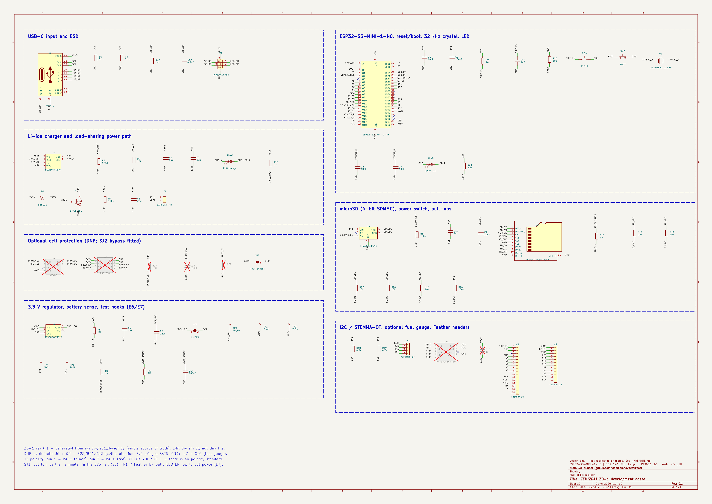
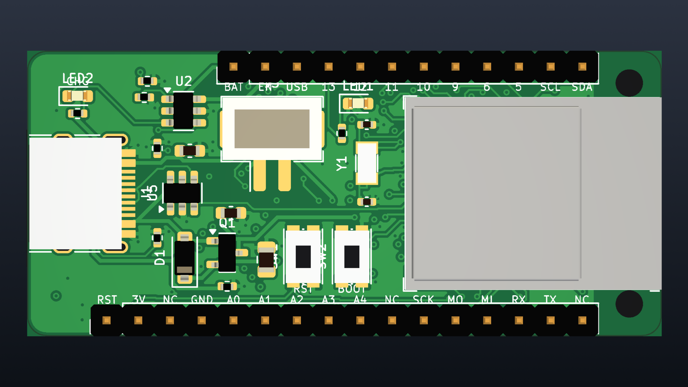
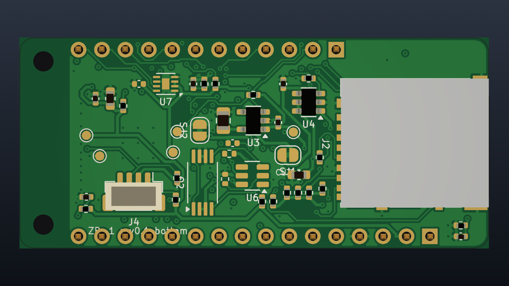
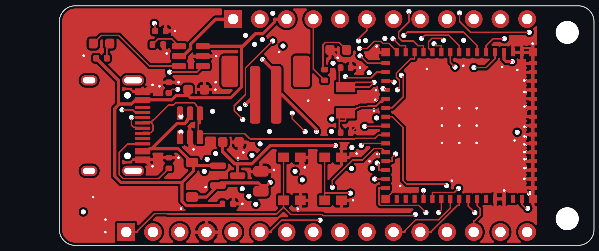
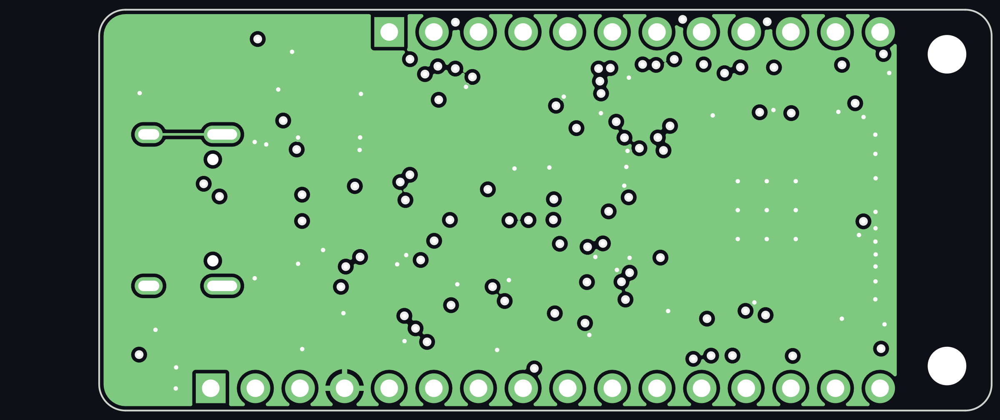
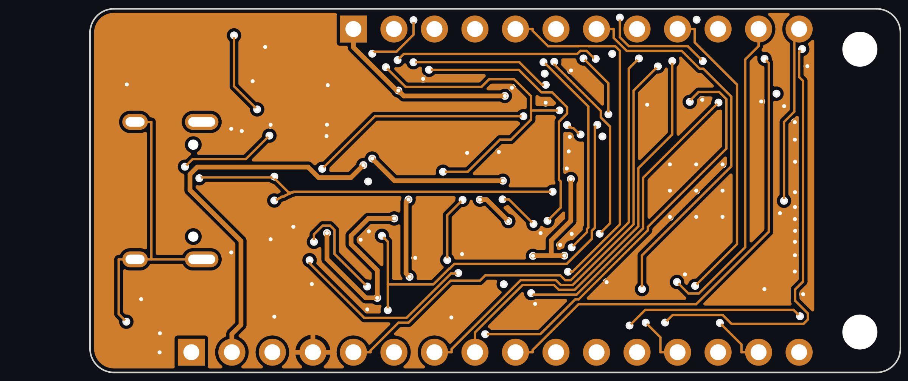
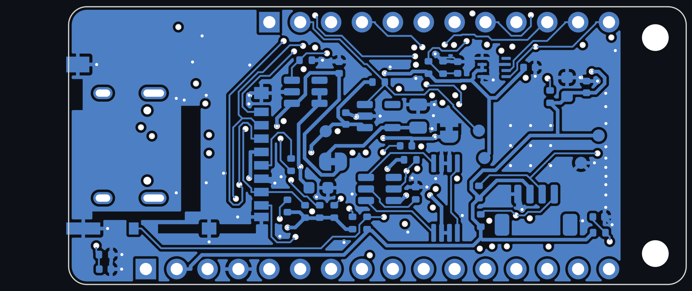
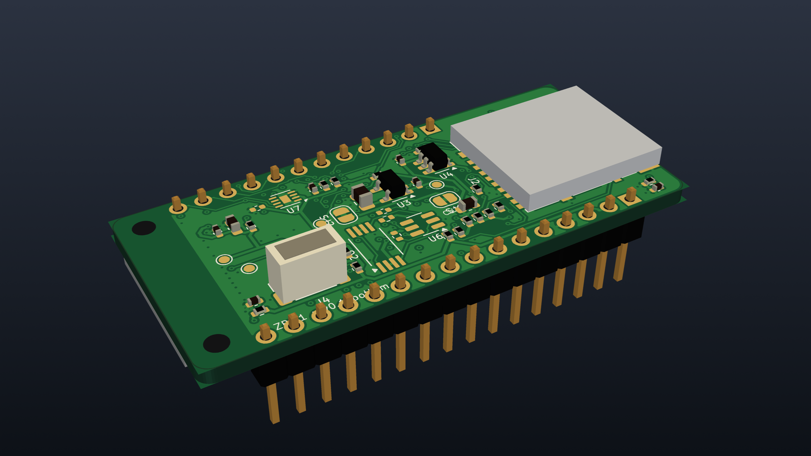

# ZB-1 CAD package — KiCad 7 schematic, 4-layer PCB, fab outputs, 3D model

This folder holds the complete electronic CAD for the [ZB-1 development board](../README.md):

* a KiCad 7 project with schematic and routed 4-layer PCB;
* Gerbers, drill, pick-and-place and BOM;
* a STEP model of the assembled board, plus rendered views.

Everything is generated by scripts from one design database (`scripts/zb1_design.py`), so the
board can be rebuilt and every number below re-checked.


> **Status: design files, not a proven board.** Nothing here has been fabricated, assembled or
> powered. The layout was placed by script and routed by an autorouter. DRC results are reported
> honestly in §5, including the items that still need a human. A qualified layout review is
> required before ordering boards; see the checklist in §7.

| | |
|---|---|
| Board | 50.8 × 22.86 mm (Adafruit Feather outline), 1.5 mm corner radius, 1.6 mm FR-4 |
| Layers | 4: F.Cu signal / In1 solid GND plane / In2 signal + GND fill / B.Cu signal + GND fill |
| Parts | 69 electrical parts + 2 mounting holes placed (7 of them DNP by default), top and bottom side |
| Routing | 1 127 track segments, 149 vias; 0.15 mm signal / 0.3 mm power / 0.2 mm USB tracks, 0.5/0.25 mm vias |
| Antenna | module antenna flush with the board edge; copper keep-out on all four layers past x = 45.4 mm |
| Netlist | schematic netlist checked pin by pin against the design database: **OK** — 69 components, 57 nets, 264 pin connections; the PCB pads were cross-checked the same way (0 mismatches) |
| DRC | **0 unconnected, 0 clearance / hole / short errors.** 8 mechanical items waived (mounting-hole courtyards, edge-mount microSD shell), 94 cosmetic warnings (silkscreen, library-copy differences) — see §5 |

## 1. Files

| Path | What it is |
|---|---|
| `zb1.kicad_pro`, `zb1.kicad_sch`, `zb1.kicad_pcb` | KiCad 7 project: open `zb1.kicad_pro` in KiCad 7.0 or newer |
| `lib/zb1.kicad_sym` | project symbols for parts KiCad 7 lacks: BQ21040, RT9080-33, DW01A, FS8205A, MAX17048 |
| `lib/zb1.pretty/ESP32-S3-MINI-1.kicad_mod` | module footprint from [espressif/kicad-libraries](https://github.com/espressif/kicad-libraries) (CC-BY-SA 4.0 with the KiCad design exception) |
| `lib/3dmodels/` | Espressif module STEP model, plus simple dimensioned envelope bodies for parts without a KiCad 3D model (USB-C, microSD, both JST connectors, KMR2 switches, crystal) |
| `fab/zb1_gerbers.zip` | Gerber X2 (11 layers) + Excellon drill (PTH and NPTH separate): upload this to a PCB fab |
| `fab/zb1_bom.csv` | grouped BOM with MPNs; DNP lines marked |
| `fab/zb1_pos.csv` | pick-and-place centroids, both sides, mm (DNP and through-hole parts excluded) |
| `docs/zb1_schematic.pdf` | schematic, one A2 sheet in seven titled blocks |
| `docs/zb1_assembly_top.pdf`, `docs/zb1_assembly_bottom.pdf` | assembly drawings (fab layer with every reference) |
| `docs/*drl_map.pdf` | drill maps |
| `3d/zb1.step` | whole assembly for enclosure/mechanical CAD (FreeCAD, Fusion, Onshape, SolidWorks) |
| `images/` | schematic PNG, per-copper-layer plots, board-surface images, 3D renders |
| `reports/drc.rpt` | full KiCad DRC report |
| `reports/netlist_check.txt` | schematic-vs-design-database check |
| `scripts/` | the generators (§6) |
| `build.sh` | rebuilds everything above from `scripts/zb1_design.py` |

## 2. Schematic



The schematic implements exactly the circuit in [`../README.md`](../README.md) §3–§5. It is drawn
in a "label per pin" style: every pin gets a short stub with its net label. It is generated from
`zb1_design.py`, so edit that file and regenerate rather than editing the schematic by hand.
`reports/netlist_check.txt` confirms that the netlist KiCad exports from the schematic matches the
database:
* every component present, with the designed footprint and value;
* every designed pin connection present;
* no extra connections.

Changes from the earlier text description, made while drawing it:

* **BQ21040 pinout** checked against the TI datasheet: 1 TS, 2 OUT, 3 /CHG, 4 ISET, 5 VSS, 6 IN.
  TS must not float (that enters a test mode), so R4 = 10 kΩ to GND stays fitted.
* **USBLC6-2SC6** is flow-through: pins 1/6 and 3/4 are the same line, so each data line is one net.
* **TPS22917 QOD** is tied to VOUT so the card's supply is actively discharged when switched off.
  CT is left open for the fastest turn-on.
* **Battery connector:** J3 pin 1 = BAT−, pin 2 = BAT+. Check this against your cell: JST-PH
  LiPo leads have no polarity standard, and a reversed cell will destroy the charger.
* **Optional cell protection:** U6 DW01A and Q2 FS8205A are drawn and laid out but DNP. SJ2
  bridges BATN to GND. Cut SJ2 if you fit them.

## 3. PCB

| Top | Bottom (seen from below) |
|---|---|
|  |  |

**Top side**
* ESP32-S3-MINI-1 with its antenna at the right-hand edge.
* USB-C at the left, with ESD protection.
* Charger and power-path parts.
* Vertical JST-PH battery jack.
* RESET and BOOT buttons.
* 32.768 kHz crystal placed against the module's XTAL_32K pins.
* Charge and user LEDs.
* Feather headers (supplied loose).

**Bottom side**
* microSD socket, slot at the USB end.
* SD load switch and pull-ups.
* LDO and the current-measurement jumper SJ1 (marked `CUT=I`).
* Battery divider.
* STEMMA-QT connector.
* Test pads TP1–TP5 for a pogo-pin fixture: TP_EN, VBAT, VSYS, 3V3, GND.
* Optional protection and fuel-gauge footprints.

| F.Cu | In1 (GND plane) |
|---|---|
|  |  |
| **In2** | **B.Cu** |
|  |  |

Layout decisions:

* **Antenna:**
  * The module sits flush with the board edge.
  * A rule area bans copper pour, tracks and vias on all four layers under and beyond the antenna (x > 45.4 mm).
  * No parts sit on either side in that zone.
* **No tracks under the module's centre on F.Cu.** A rule area 1.4 mm inside the pad ring allows
  only vias and the GND pour there. Pads may take a short inward stub to a via (standard practice
  for LGA modules, and needed to escape 0.85 mm-pitch pads). The centre GND pad has nine via-in-pad
  stitches to the In1 plane; specify them filled and capped, or tented from the bottom.
* **GND:**
  * In1 is an unbroken plane.
  * F.Cu, In2 and B.Cu are GND-filled with thermal reliefs.
  * Every SMD GND pad that had room received its own via to the plane before routing.
* **Mounting holes:**
  * Only the two antenna-end Feather holes (M2) are present.
  * The two USB-end holes collide with the microSD socket on the bottom and were omitted — a deliberate deviation from the Feather specification.
  * The antenna-end holes touch the module courtyard, exactly as on Adafruit's own ESP32-S3 Feather.
* **Silkscreen:**
  * Feather pin names on the top.
  * Battery polarity marks, button names and board name on the top.
  * Passive references only on the assembly drawings, to keep the silkscreen legible.
  * No serial numbers or unique identifiers ([`../README.md`](../README.md) R8).

### Design rules used

Set for a standard 4-layer prototype service (JLCPCB/PCBWay class): track/space 0.15/0.15 mm
signal (fab minimum is typically 0.09–0.1 mm), 0.3 mm power, via 0.5 mm pad / 0.25 mm drill,
hole-to-copper 0.2 mm, copper-to-edge 0.25 mm. **Check the 0.25 mm drill against your fab's
standard (not premium) capability before ordering.**

## 4. 3D model



`3d/zb1.step` contains the bare board and every fitted part:
* the real Espressif module model;
* KiCad library models for the passives, ICs and headers;
* simple dimensioned envelope bodies for the six parts KiCad 7 ships no model for (USB-C, microSD socket, JST-PH vertical, JST-SH vertical, KMR2 switches, 3215 crystal).

The envelopes are correct in footprint position and outline size, so they are good enough for
designing an enclosure, but they are not detailed parts. DNP parts are omitted. The renders
overlay the board's real copper, mask, ENIG pads and silkscreen, composited from the KiCad layer
plots, onto the STEP geometry.

## 5. DRC result and what still needs a human

Report: [`reports/drc.rpt`](reports/drc.rpt), KiCad 7.0.11 DRC run on the saved board with all zones
refilled.

| Category | Count | Severity | Status |
|---|---|---|---|
| Unconnected items | **0** | error | every net is routed |
| Clearance, hole clearance, shorts, track width, annular ring, keep-out violations by copper | **0** | error | — |
| Courtyard overlap: M2 holes H3/H4 vs module U1 and the header rows | 4 | error | **waiver.** These are the screw-head courtyards of the antenna-end Feather holes, with exactly the same geometry as Adafruit's ESP32-S3 Feather. The holes are NPTH, with no copper. Use nylon screws or bottom-side standoffs only. |
| Items not allowed: H3/H4 courtyard inside the module footprint's antenna keep-out | 2 | error | **waiver** for the same holes: no copper and no parts sit in the keep-out; only the screw-head clearance circle touches it. Drop H3/H4 entirely if you prefer a strictly clean report. |
| Copper to board edge: microSD shell tabs (J2 pad 11) | 2 | error | **waiver.** The socket is edge-mounted by design: its slot is at the board edge. The tabs are GND. |
| Silkscreen overlap / clipped by mask / clipped by edge | 73 | warning | cosmetic. Mostly footprint outlines on dense 0402 areas and the USB-C/microSD outlines that cross the edge. The fab clips silk to mask (`--subtract-soldermask`). |
| Footprint differs from library copy | 21 | warning | expected: these footprints were given envelope 3D models or the DNP attribute in the board |

**How routing was completed.** Three routing tools were involved, in order:

1. **Maze pre-route (`scripts/complete.py`).** A small net-aware A* router on a 0.05 mm grid
   routes a few nets first and locks them:
   * the USB D+/D− lines;
   * both 32 kHz crystal lines;
   * the ESD chip's VBUS hop;
   * one protection-circuit hop.
2. **Freerouting 1.4.4.** It routes everything else around the locked nets.
3. **Maze completion pass.** It closes whatever Freerouting left open, with local rip-up and
   retry. It also does two clean-ups:
   * moves a stranded test pad next to its own net;
   * trims short dangling stubs, with connectivity checked after each removal.

Freerouting is deterministic for a given input, but small input changes reshuffle its result. So
`scripts/best_of.py` tries three pre-route sets and keeps the best. Result:

| Pre-route set | Unconnected |
|---|---|
| A | 1 |
| **B** | **0** (used) |
| C | 1 |

**What still needs a human before ordering** (beyond the checklist in §7):

* **Trace quality, not just legality.** The routing is DRC-clean but autorouted: there are
  detours and more vias than a hand layout would have. Re-routing the charger/power-path loop and
  shortening the SD bus are worthwhile.
* **USB D+/D−** are routed as two single 0.2 mm tracks, not a coupled 90 Ω pair. That is
  acceptable for 12 Mbit/s full-speed, but re-route them as a pair if you touch that area.
* **Via-in-pad under the module centre (9 vias):** order them filled and capped, or tented.
* **Test pad TP3 (VSYS)** sits beside the regulator rather than in the TP row, because the router
  could not reach the original spot.

## 6. How it was generated (and how to change it)

```
scripts/zb1_design.py     single source of truth: every part, footprint, value, MPN, pin -> net
scripts/gen_libs.py       project symbols + module footprint/3D model
scripts/gen_models.py     envelope STEP bodies for parts without library models
scripts/gen_schematic.py  zb1.kicad_sch (A2, seven blocks), verified by verify_netlist.py
scripts/gen_pcb.py        outline, fixed placements, greedy courtyard-clearing placement of the rest,
                          antenna keep-out, module no-track area          -> build/zb1_placed.kicad_pcb
scripts/route.py          GND fan-out vias, Specctra DSN (with In1 GND plane), Freerouting -> build/zb1.ses
scripts/finish.py         session import, GND pours on 4 layers, silkscreen, zone fill, DRC
scripts/export.py         Gerbers/drill/pos/BOM, PDFs, STEP, layer plots, surface textures, renders
scripts/texture.py        mask/copper/ENIG/silk composite of the KiCad layer plots
scripts/render3d.py       STEP -> OpenCASCADE -> VTK off-screen renders
```

To change the circuit:
1. Edit `zb1_design.py`.
2. Run `./build.sh`.

To move parts, edit `FIXED` / `TARGET` in `gen_pcb.py`.

**Toolchain used (2026-10-19):**
* KiCad 7.0.11 (Ubuntu 24.04 packages, with the symbol, footprint and 3D libraries).
* Freerouting 1.4.4 built from source. The only local patch is an optional time cap on the
  post-route optimiser (`-Dzb1.opt.seconds`), set to 600 s here.
* OpenCASCADE (cadquery-ocp) and PyVista/VTK for the renders.
* Shapely for placement geometry.

KiCad 8/9 will open and upgrade the project.

## 7. Review checklist before ordering

1. Open `zb1.kicad_pro` in KiCad, run DRC, and finish or clean up anything listed in §5.
2. USB D+/D−: the autorouter does not do differential pairs. At USB 2.0 full speed (12 Mbit/s,
   which is what the S3's USB block runs) this is tolerable, but re-route them as a 90 Ω pair if
   you touch the area.
3. Check the power-path and charger loop areas (VBUS → U2 → VBAT → Q1 → VSYS → U3). The 0.3 mm
   power tracks carry at most 500 mA charge current or about 350 mA module peak; widen where
   space allows.
4. Check the BQ21040 R_ISET, the RT9080 pinout (VIN-GND-EN-NC-VOUT) and the DW01A/FS8205A pinouts
   against the datasheets of the exact parts you buy. Second-source parts differ.
5. Confirm J3 polarity against your battery (§2).
6. Confirm the microSD and USB-C footprints against the exact connector part numbers in the BOM.
   Look-alike parts often have different shell-pad positions.
7. Order 5 bare boards plus a stencil, or PCBA, and run the bring-up procedure in [`../README.md`](../README.md) §10.
