<div align="center">

# ZEMIZDAT

**Offline, identity-free exchange of short written "pamphlets" between strangers — over
nothing but Bluetooth broadcasts from cheap battery-powered devices.**

[](https://github.com/danindiana/zemizdat/actions/workflows/tests.yml)


-success)
[](LICENSING.md)
[](https://github.com/danindiana/zemizdat/commits/main)
[](https://github.com/danindiana/zemizdat)
[](https://github.com/danindiana/zemizdat/stargazers)

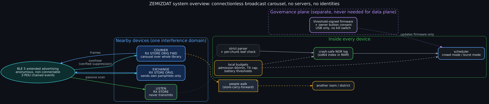

</div>

---

## Contents

1. [What this is](#1-what-this-is)
2. [The question, and the short answer](#2-the-question-and-the-short-answer)
3. [How it works](#3-how-it-works)
4. [What the evidence says](#4-what-the-evidence-says)
5. [What does not work (yet), and why](#5-what-does-not-work-yet-and-why)
6. [Repository map](#6-repository-map)
7. [Reproduce everything](#7-reproduce-everything)
8. [Hardware](#8-hardware)
9. [Related projects](#9-related-projects)
10. [Next step](#10-next-step)
11. [Evidence labels and honesty notes](#11-evidence-labels-and-honesty-notes)
12. [Diagrams](#12-diagrams)
13. [Status, licence, provenance](#13-status-licence-provenance)

---

## 1. What this is

ZEMIZDAT is a proposed pocket device inspired by *samizdat*, the hand-copied, hand-passed
literature of the Soviet era. Each device carries short texts — ideas, questions, arguments,
observations — called **pamphlets**. When devices come near each other they exchange pamphlets
over radio, with no internet, no phone network, no server, no account and no stable identity.
People carry pamphlets from room to room and district to district simply by walking around.

The system is **content-neutral**. It never decides what is true or acceptable. Each owner
decides what to publish, keep, delete and pass on.

This repository holds the complete pre-prototype engineering investigation
(mission brief: [`MISSION.md`](MISSION.md)):

* a formal model;
* four compared architectures;
* a byte-exact protocol specification;
* executable reference implementations in Python and C;
* a 377-run simulation campaign;
* an adversarial review;
* a hardware assessment;
* a falsifiable plan for the first hardware experiment.

> **Nothing here has been measured on hardware yet.** Every performance number is either
> *simulated* or *calculated*, and is labelled that way in the documents.

## 2. The question, and the short answer

> *Can thousands of independently operating, inexpensive, battery-powered devices exchange and
> propagate compact written information through spontaneous wireless encounters, while
> minimising duplicate storage, radio traffic, computation and dependence on centralised
> infrastructure?*

**Short answer: yes, conditionally.** The design is simpler than a mesh network, but some of
its limits are set by physics rather than engineering.

* **A connectionless broadcast "carousel" works.** There are no connections, keys, identities,
  routing or reconciliation protocol, and it serves everyone in range, including devices that
  never transmit. Simulated results:
  * 100 % of pamphlets within an hour in a hall of up to ~500 devices;
  * 95 % at 1 000 devices;
  * 98 % across six rooms of 500 people who walk between rooms;
  * 100 % across a simulated city of 3 000 people in 24 h.
* **A crowd adds receivers, not capacity.** One hall's shared airtime moves about 300 kB/s of
  pamphlet bytes. With 3 000 devices in one room, about 40 % of the collection reaches the
  average person in an hour.
* **Density-adaptive rate control is the indispensable mechanism.** Whether a real device can
  observe enough of the interference to run that control is **the largest open risk**.
* **Flooding is jamming, and interdiction beats majorities.** These are limits, not bugs, and
  they are proved or demonstrated in the repository.

Full verdict: [`09_final/EXECUTIVE_VERDICT.md`](09_final/EXECUTIVE_VERDICT.md).

## 3. How it works

### 3.1 Devices and modes

Each device has four owner-set permission bits — `RX`, `STORE`, `ORIG` (send my own), `FWD`
(send others') — exposed as three presets:

| Preset | Transmits | Receives | Privacy |
|---|---|---|---|
| **LISTEN** | never (passive scanning) | yes | discloses nothing — not even its presence |
| **EXCHANGE** | its own pamphlets | yes | discloses what it authored |
| **COURIER** | everything it carries | yes | discloses what it carries; bridges rooms and districts |

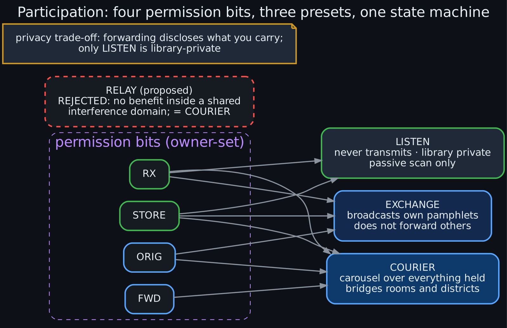

### 3.2 Content identity

A pamphlet is an immutable *canonical object* of at most 4 064 bytes (12-byte header, ordered
metadata, UTF-8 body). It is split into 220-byte chunks. Each chunk gets a truncated hash (a
*leaf*), and the pamphlet's identifier is the hash of its length and all its leaves. A small
**manifest** frame carries the leaves.

* A receiver can check **every chunk the moment it arrives**, so it can safely collect pieces
  from different senders, minutes or hours apart.
* A forged chunk is rejected on its own and can never spoil a reassembly.
* A pamphlet of up to 208 bytes is a single self-certifying frame.

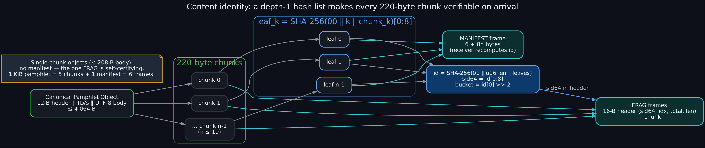

### 3.3 The radio and the carousel

Frames of ≤ 236 bytes ride in anonymous, non-connectable BLE 5 *extended advertisements*, chained
three per event. Every device allowed to transmit runs a carousel with two modes:

* **Crowd mode** — many transmitters nearby. The device's event rate is scaled so the whole
  room's channel load stays near the optimum (primary-channel load ≈ 0.25, secondary ≈ 0.15).
  If it overhears someone else sending a pamphlet it holds, and the bytes match its own copy, it
  skips that pamphlet (*verified suppression*).
* **Burst mode** — eight transmitters or fewer, e.g. two people passing in a street. Contact
  time is the scarce resource, so the device listens continuously and sends fast.

Which pamphlet to send is weighted toward **items nobody nearby has sent recently**. Every
device can observe that locally, and it beat inventory-summary beacons in the simulations.

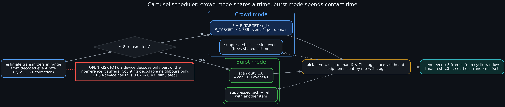

### 3.4 Receive path and storage

The receive path validates every field before touching any state, uses no heap, and holds
partial objects in at most 8 fixed staging slots. Completed objects are admitted (60 per minute
at most) and committed to a log-structured NOR-flash store. That store survives a power cut at
any byte, including during garbage collection — tested exhaustively.

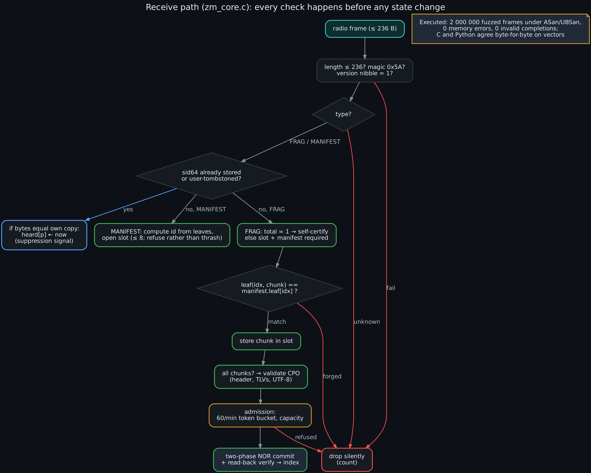
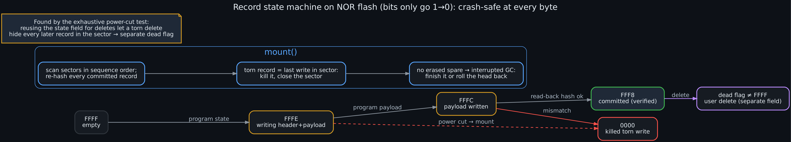

### 3.5 Layers at a glance

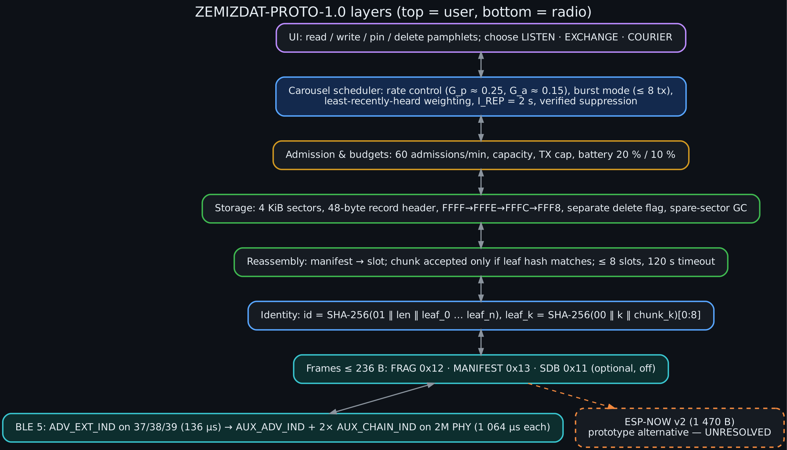

Normative specification: [`03_protocol/ZEMIZDAT_PROTO_1.0.md`](03_protocol/ZEMIZDAT_PROTO_1.0.md)
and [`03_protocol/wire_format.md`](03_protocol/wire_format.md), which includes byte-exact worked
examples generated by the reference code.

## 4. What the evidence says

### 4.1 Executed (code in this repo, run in CI)

| Check | Result |
|---|---|
| Python reference: codec, reassembly, forged chunks, parser fuzz, storage | **31 tests pass** |
| Power cut at **every** programmed byte and erase, including GC | 0 corrupt, 0 duplicated records; at most one in-flight delete lost |
| C99 receive path vs Python on test vectors | **byte-identical** (8/8 objects, 46/46 duplicates rejected) |
| C fuzz: 2 000 000 mutated frames under AddressSanitizer + UBSan | 0 memory errors, 0 invalid completions |
| Receiver static RAM (4 slots) | 17 428 B |
| Simulator invariants (bookkeeping, determinism, LISTEN never transmits, collapse, partitions, capacity) | **14 tests pass** |
| XOR-fold inventory beacon (prior design) | one beacon reveals 100 % of a library at M = 300, 97 % at M = 1 000 → design replaced |

### 4.2 Simulated (`06_simulation`, 377 runs)

All numbers are mean completeness of honest receivers, listeners included.

| Scenario | HYBRID (this design) | rate-controlled broadcast | fixed-rate broadcast | pairwise anti-entropy |
|---|---|---|---|---|
| hall, 100 devices, 1 h | 1.00 | 1.00 | 1.00 | 0.80 (listeners 0) |
| hall, 1 000 devices, 1 h | **0.95** | 0.61 | 0.39 | 0.80 (listeners 0) |
| hall, 3 000 devices, 1 h | **0.40** | 0.36 | **0.00** | 0.28 (listeners 0) |
| 6 rooms × 500, walking, 1 h | **0.98** | 0.65 | — | 0.75 (listeners 0) |
| city of 3 000, 24 h | **1.00** (0.49 without burst mode) | 0.58 | — | 0.80 (listeners 0) |

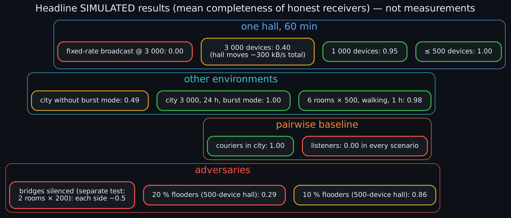

Figures generated from the raw runs (`06_simulation/results/`):

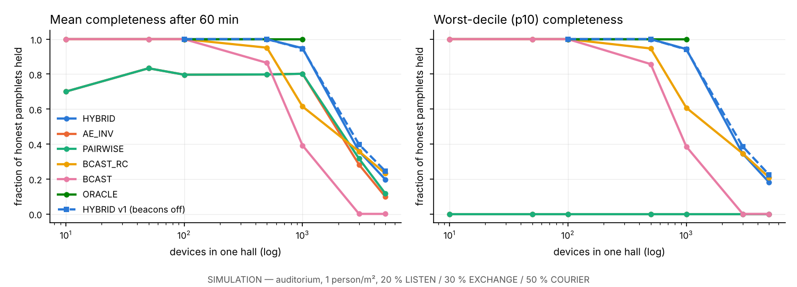
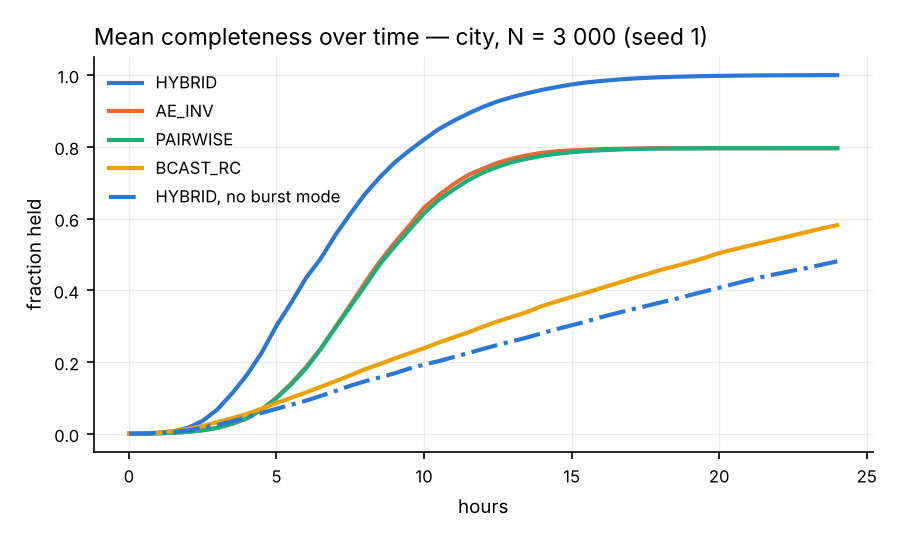 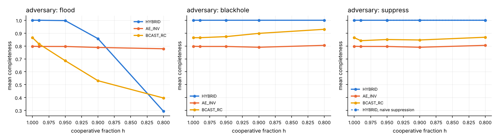

### 4.3 Calculated (`04_mathematical_analysis/scripts`)

* An extended-advertising event is 3 × 136 µs primary pointers plus 1 064 µs per chained PDU on
  2M PHY. The optimal chain is ≈ 3 PDUs. One interference domain moves ≈ 1 500 frames/s
  (≈ 336 kB/s of pamphlet bytes), however many devices share it.
* Fixed-rate (10 Hz) advertising peaks at ~100 transmitters per domain and is dead by a few
  hundred.
* Receiving 3 000 one-KiB pamphlets in one dense hall takes **≥ 20–24 minutes even with perfect
  scheduling** at 30 % scan duty.
* Broadcast saves ≈ 100× in bits on air versus unicast — one copy per *reception tile*, not
  per person.

## 5. What does not work (yet), and why

| Limit | Kind | Where |
|---|---|---|
| Thousands in one room cannot all get everything quickly | physics (shared airtime) | [`communication_bounds.md`](04_mathematical_analysis/communication_bounds.md) |
| Rate control must sense interference it cannot decode; counting decodable neighbours only drops a 1 000-device hall from 0.82 to 0.47 | **open research question Q1** | [`RESEARCH_QUESTIONS.md`](09_final/RESEARCH_QUESTIONS.md) |
| A device that floods the channel is a jammer (20 % flooders → 0.29) | physics | [`counterexamples.md`](07_adversarial_review/counterexamples.md) |
| Anonymous publishing + finite storage + guaranteed retention is impossible | proved (Theorem D) | [`impossibility_results.md`](01_formal_model/impossibility_results.md) |
| Removing the few people who carry pamphlets between groups partitions the network, however cooperative everyone else is | proved + simulated | [`temporal_graphs.md`](04_mathematical_analysis/temporal_graphs.md) |
| Couriers are fingerprintable by what they carry; only LISTEN is library-private | proved | same |
| No device can know it holds "everything" | proved (Theorem G) | same |

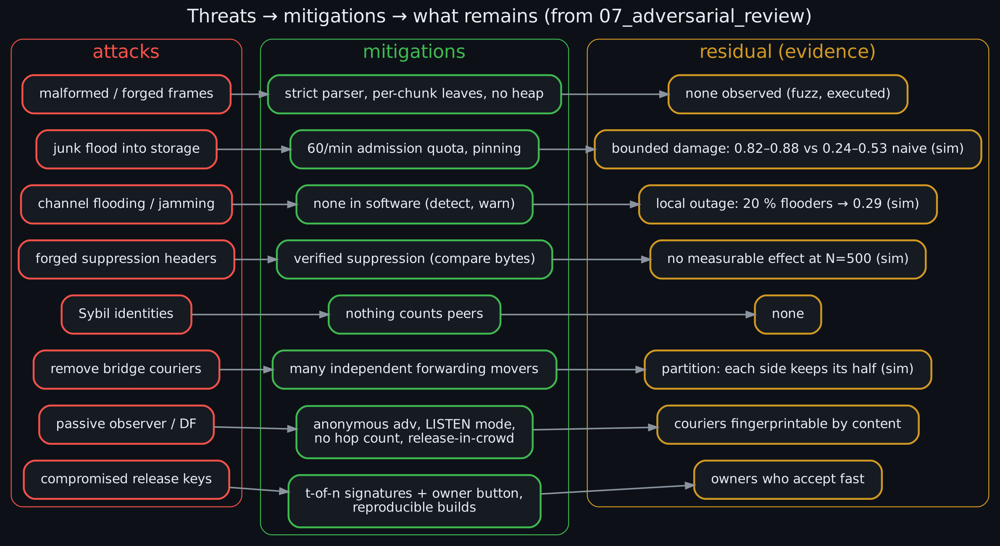

## 6. Repository map

```
zemizdat/
├── README.md                       ← you are here
├── MISSION.md                      original brief (ZEMIZDAT-ARGON-1.0)
├── STATE.json                      machine-readable status, verdicts, open items
├── diagrams/                       12 diagrams (.dot source + .png + .svg)
├── 01_formal_model/                system definition, invariants I1–I10, liveness, impossibility A–J
├── 02_candidate_architectures/     broadcast, pairwise, hybrid, store-carry-forward,
│                                   comparison + verdicts, prior-art survey
├── 03_protocol/
│   ├── ZEMIZDAT_PROTO_1.0.md       normative spec
│   ├── wire_format.md              byte layouts + worked examples
│   ├── state_machine.md · synchronization.md · storage.md · security.md
│   ├── reference_py/               zmproto.py + 31 tests
│   └── reference_c/                zm_core.[ch], vectors, fuzz harness, Makefile
├── 04_mathematical_analysis/       bounds, temporal graphs, convergence, uncertainty
│   ├── scripts/                    airtime_model.py, sync_costs.py, xor_digest_attack.py
│   └── results/                    their JSON outputs
├── 05_hardware/                    UNO R4 WiFi, ESP32-S3, nRF52840, battery, BOM, dev boards
│   └── zb1/                        ZB-1 board design: spec, pinmap, BOM, Arduino variant, bring-up sketch
│       └── cad/                    KiCad 7 schematic + routed 4-layer PCB, Gerbers, STEP, renders, generators
├── 06_simulation/                  simulator.py, run_experiments.py, analyze.py,
│                                   tests/, configs/, results/ (runs.jsonl, summary.md, figures)
├── 07_adversarial_review/          threat model, 15 counterexamples, failure matrix, mitigations
├── 08_verification/                hardware test plan E1–E7, properties, acceptance tests, gaps
└── 09_final/                       verdict, architecture decision, spec index, research
                                    questions, prototype plan, next action, Gemini audit
```

**Suggested reading order:**

1. `09_final/EXECUTIVE_VERDICT.md`
2. `09_final/ARCHITECTURE_DECISION.md`
3. `03_protocol/ZEMIZDAT_PROTO_1.0.md`
4. `04_mathematical_analysis/convergence.md`
5. `07_adversarial_review/counterexamples.md`
6. `08_verification/test_plan.md`

## 7. Reproduce everything

Requirements: Python ≥ 3.11, `numpy ≥ 2`, `matplotlib`, `pytest`, and gcc or clang with
sanitizers; Graphviz only to re-render the diagrams.

```bash
git clone https://github.com/danindiana/zemizdat && cd zemizdat
pip install "numpy>=2" matplotlib pytest

# protocol reference (≈ 20 s)
(cd 03_protocol/reference_py && python -m pytest -q)

# C receive path: Python-generated vectors + 2M-frame sanitizer fuzz (≈ 1 min)
(cd 03_protocol/reference_c && make test)

# analytical models
(cd 04_mathematical_analysis/scripts && python airtime_model.py && python sync_costs.py && python xor_digest_attack.py)

# simulator tests (≈ 30 s), then the full campaign (≈ 6–8 CPU-hours, resumable)
cd 06_simulation
python -m pytest -q tests
python run_experiments.py --jobs 2     # appends to results/runs.jsonl, skips finished runs
python analyze.py                       # regenerates results/summary.md and figures

# one ad-hoc run
python simulator.py --N 1000 --T 1800 --strategy HYBRID --sdb false

# diagrams
cd ../diagrams && for f in *.dot; do dot -Tpng -Gdpi=160 "$f" -o "${f%.dot}.png" && dot -Tsvg "$f" -o "${f%.dot}.svg"; done
```

## 8. Hardware

| Option | Verdict | Why |
|---|---|---|
| Arduino UNO R4 WiFi | **reject for production**; bench helper | 32 KB SRAM on the RA4M1 and no radio; its ESP32-S3 can be flashed directly, and the RA4M1 can drive power-cut tests |
| ESP32-S3 | **conditional** (prototype) | fits easily; module datasheet gives BLE receive at 93 mA (peak), so ~2 days on 2000 mAh in a crowd |
| nRF52840 + 8 MB SPI NOR | **conditional** (production candidate) | radio ≈ 6.3 mA receive / 6.4 mA transmit at 0 dBm (datasheet); runs directly from a Li-ion cell |
| nRF54L15 | unresolved | datasheet figures not yet reviewed |

* Board shortlist with prices: [`05_hardware/dev_boards.md`](05_hardware/dev_boards.md).
  Best value is the Seeed XIAO nRF52840.
* Battery arithmetic, clearly marked as estimates:
  [`05_hardware/battery_budget.md`](05_hardware/battery_budget.md).

### ZB-1 development board (design, not yet built)

[`05_hardware/zb1/`](05_hardware/zb1/README.md) is a purpose-built Feather-size board:

* ESP32-S3-MINI-1-N8 (BLE 5 extended advertising, Wi-Fi, native USB, 8 MB NOR for the pamphlet log);
* USB-C LiPo charging (BQ21040) with a load-sharing power path and a 2 µA-Iq LDO;
* a power-switched 4-bit microSD slot (SDSC/SDHC/SDXC up to 2 TB; exFAT via SdFat or FAT32 reformat);
* test hooks for energy (E6) and power-cut (E7) experiments;
* ≈ $10–13 at qty 100 [estimate].

It is programmable from the Arduino IDE: a `boards.txt` entry and variant are included, and the
bring-up sketch (anonymous extended advertising + passive scan through `zm_core.c`) compiles.
Because ESP32-S3 BLE receive costs 93 mA versus 6.26 mA on the nRF52840, the design document
recommends an nRF52840-based ZB-2 for a pocket device.


The full CAD package is in [`05_hardware/zb1/cad/`](05_hardware/zb1/cad/README.md). It contains:

* a KiCad 7 schematic and a routed 4-layer PCB;
* Gerbers, drill, pick-and-place and BOM;
* a STEP model of the assembled board;
* the scripts that generate all of it from one design database.

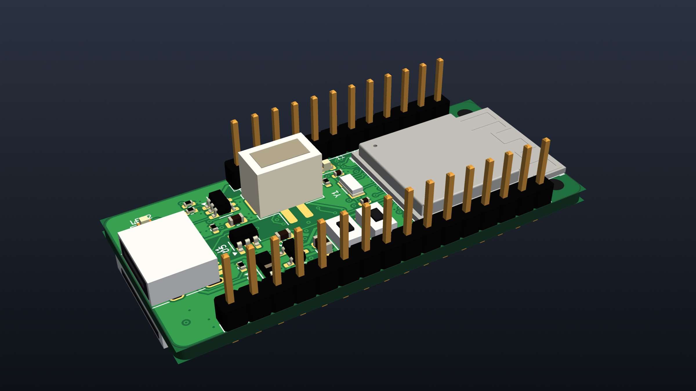

## 9. Related projects

No open-source project found combines receive-only participation, no identity on air, and
content-addressed microcontroller firmware. The closest relatives are Rumble (epidemic
store-carry-forward on Android), Serval Rhizome/LBARD (content-addressed bundle sync over
constrained radios), bitchat (BLE mesh chat), Meshtastic and MeshCore (LoRa microcontroller
firmware), Reticulum LXMF (propagation nodes), and OpenHaystack (passive pickup of BLE
advertisements by bystanders).

Lessons from the security failures of comparable apps, notably Bridgefy and early bitchat, are
in [`02_candidate_architectures/prior_art.md`](02_candidate_architectures/prior_art.md).

## 10. Next step

**Experiment E1 + E2:** two ESP32-S3 and two nRF52840 boards, anonymous chained non-connectable
extended advertising, and a silent receiver that must rebuild and verify every test-vector
pamphlet. A sniffer must see nothing at all from the receiver.

It costs about $60 and about a week. It is the cheapest test that could invalidate the whole
architecture, and every failure mode has a predefined fallback. Details:
[`09_final/NEXT_ACTION.md`](09_final/NEXT_ACTION.md) and
[`08_verification/test_plan.md`](08_verification/test_plan.md).

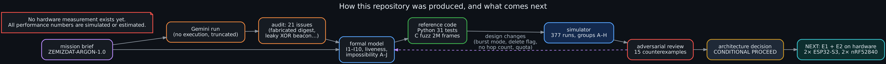

## 11. Evidence labels and honesty notes

Every claim in the documents carries one of these labels:

| Label | Meaning |
|---|---|
| **[spec]** | manufacturer datasheet or standard |
| **[executed]** | checked by code in this repository |
| **[simulated]** | output of `06_simulation` |
| **[estimate]** | calculation with stated assumptions |
| **[assumption]** | to be replaced by an experiment |

Defects found and fixed during the work are documented rather than hidden:

* the torn-delete storage bug;
* a carousel re-send bug;
* pairwise baselines not being charged for flooders' airtime;
* a wrong first model of time-stratified admission;
* a negative-count bug.

The earlier attempt at this mission, by another model, is audited in
[`09_final/AUDIT_OF_GEMINI_RUN.md`](09_final/AUDIT_OF_GEMINI_RUN.md): 21 issues, including a
fabricated hash and an inventory beacon that leaked whole libraries.

Explicitly **not** claimed: "uncensorable", "untraceable", "jam-proof", or anything about the
truth or legality of content.

## 12. Diagrams

All diagrams are in [`diagrams/`](diagrams) as editable Graphviz `.dot`, plus `.png` and
`.svg` renders.

| # | Diagram | Shows |
|---|---|---|
| 01 | `01_system_overview` | devices, the air interface, device internals, store-carry-forward, governance plane |
| 02 | `02_protocol_stack` | layers from UI down to BLE PDUs |
| 03 | `03_content_identity` | chunks → leaves → identifier; manifest and fragment frames |
| 04 | `04_receive_path` | validation order in `zm_core.c` |
| 05 | `05_carousel_scheduler` | crowd mode vs burst mode, weighting, the open rate-control risk |
| 06 | `06_storage_states` | NOR record state machine and mount-time recovery |
| 07 | `07_participation_modes` | permission bits → LISTEN / EXCHANGE / COURIER; RELAY rejected |
| 08 | `08_threats_mitigations` | attack → mitigation → residual risk with evidence |
| 09 | `09_research_pipeline` | how this repo was produced and what comes next |
| 10 | `10_simulated_results` | headline simulated numbers (explicitly not measurements) |
| 11 | `11_zb1_block_diagram` | ZB-1 development board blocks and buses |
| 12 | `12_zb1_power_tree` | ZB-1 charger, power path, rails and battery budget |

## 13. Status, licence, provenance

* **Status:** pre-prototype. The architecture verdict is *conditional proceed*, pending hardware
  experiments E1 (link), E5 (congestion and rate control), E6 (energy) and E7 (power cuts on
  real flash).
* **Licence:** open source, © 2026 Benjamin W. Denio, licensed in three permissive parts.
  [`LICENSING.md`](LICENSING.md) says which paths each covers.

  | Part | Licence |
  |---|---|
  | Code | [Apache-2.0](LICENSES/Apache-2.0.txt) |
  | ZB-1 hardware design | [CERN-OHL-P-2.0](LICENSES/CERN-OHL-P-2.0.txt) |
  | Documentation, diagrams, data | [CC-BY-4.0](LICENSES/CC-BY-4.0.txt) |

  The Espressif module footprint and 3D model keep their own CC-BY-SA 4.0 licence (see [`NOTICE`](NOTICE)).
* **Provenance:** produced in October 2026 by Benjamin with Claude (Anthropic) acting as
  research and engineering assistant, from the ZEMIZDAT-ARGON-1.0 brief. Datasheet facts were
  fetched and cited at the time; prices are point-in-time retail observations.
